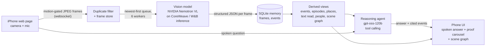

# RecallAI

**Remember. Reason. Prove.**

RecallAI is a memory layer for smart glasses. A camera watches your day and keeps only the moments that matter. A vision model turns those moments into structured memory (objects, places, activity, people in view, text on signs). You then ask questions out loud, such as *"Where did I leave my keys?"* or *"What did I do today?"*, and get a spoken answer together with the exact frame that proves it. When there is no evidence, it says **"I have no record"** instead of guessing.

Built for the Real-Time Video Agents Hack (London).

## What it can do

- **Where did I leave X?** Finds the last time an object was picked up or put down, and shows the frame.
- **What did I do today?** Summarises the day as episodes: what, where, and for how long, including gaps when the camera saw nothing.
- **Was I outside? Where did I go?** Tracks places and indoor or outdoor, including short visits.
- **What was the name of that shop?** Reads legible text from signs and shopfronts.
- **Did I see anyone?** Records that people were in view and how many. It never identifies anyone.
- **Scene graph.** A live graph of objects and relationships, with a time slider, event markers and replay.
- **Honest refusals.** If the evidence isn't there, it says so, and it states what it does not track.

## Architecture



**The three stages**

1. **Remember (capture and filter).** The phone page checks for motion about 30 times a second and sends a frame only when the scene changes, or every 2 seconds at most. On the laptop, a perceptual hash drops near-duplicates. Most frames are never stored, and old kept frames shrink to thumbnails unless they back an event.
2. **Reason (perceive and understand).** Each kept frame goes to a vision-language model that returns strict JSON: objects and states, place, setting, activity, number of people in view, and legible text. Plain code (not the model) then derives the memory from that JSON: debounced pick-up and put-down events, activity episodes, place visits, merged sign text, people sightings, and the scene graph. A reasoning agent answers questions by calling tools over those views. It sees only tool results and must cite the events it used.
3. **Prove (evidence).** Every answer carries the ids of the events it relied on. The UI shows only those frames, with captions and timestamps, in a swipeable carousel. Nothing uncited is shown.

**Design choices worth knowing**

- **Decoupled stages.** Capture, perception and reasoning don't block each other. If the model falls behind, the pipeline keeps the newest waiting frame and drops older ones, so the memory stays current.
- **Boundaries come from code, not the model.** Event debouncing, flicker absorption and gap detection are deterministic, which keeps the memory consistent and the answers auditable.
- **Noise guards.** Events need confirmation in 2 consecutive frames; people and sign text need 2 or more frames; one-frame misreads are ignored.
- **Privacy by design.** People are recorded as presence and a count only. No faces are matched and no identities are stored.
- **Small memory.** The structured memory is a few kilobytes. The only large data is the retained frames.
- **Every server start is a new session.** On startup the server deletes the previous session's frames and database.

## Technology

| Role | Technology |
|---|---|
| Vision-language model (perception) | **NVIDIA Nemotron-3.5-Super-VL-120B** |
| Inference platform and GPUs | **Weights & Biases serverless inference, powered by CoreWeave** |
| Reasoning agent (tool calling) | `gpt-oss-120b` on the same inference service |
| Server | Python, FastAPI, SQLite, Pillow |
| Phone and web UI | Single-file web app: camera, push-to-talk, scene graph |
| Speech out | Microsoft Edge TTS (generated on the laptop, played on the phone) |
| Speech in | Browser speech recognition (Safari on iPhone) |

The pipeline is VSS-style (video in, structured descriptions, searchable memory). It does not use the NVIDIA VSS blueprint or Cosmos directly. Weave tracing is not integrated.

## Run it yourself

**Requirements:** Python 3.11+, a Windows, macOS or Linux laptop, an iPhone (or any phone with a rear camera and a modern browser), and [ngrok](https://ngrok.com/) (free account) so the phone can reach the laptop over HTTPS, which the camera requires.

1. **Install**
   ```bash
   pip install -r requirements.txt
   ```
2. **Add your key.** Create a `.env` file in the project root (it is git-ignored):
   ```
   COREWEAVE_KEY=your_weights_and_biases_inference_key
   ```
3. **Start the server**
   ```bash
   uvicorn server.main:app --port 8000
   ```
4. **Expose it over HTTPS** in a second terminal
   ```bash
   ngrok http 8000
   ```
5. **Open the ngrok URL on the phone** in Safari (tap through ngrok's warning page the first time).

> Every server start wipes the previous session. Don't restart between recording your footage and asking questions.

## How to use it

1. **Start the camera.** Tap **Start camera** and allow camera access. The badge in the top-left of the camera shows **REC** when frames are reaching the laptop. **RECONNECTING** or **NO SIGNAL** (amber) means they aren't. Keep the phone unlocked with the page in the foreground.
2. **Live your day.** Put things down, move around, walk outside, show a sign for 8 to 10 seconds. Give the memory about 10 seconds to catch up before asking.
3. **Ask.** Hold the round mic button and speak, then release, or tap one of the example questions. The answer is spoken and written, with proof frames underneath.
4. **Review proof.** Tap the frames row under an answer to open its carousel and swipe through. Older answers stay in the conversation above; scroll up to go back.
5. **Scene tab.** Open **Scene** to see objects and relationships. Drag the slider to any moment, tap a coloured tick to jump to an event (teal is put down, amber is picked up), press **Replay** to play the session back, or **Live** to follow the present.

**Example questions:** "Where did I leave my keys?", "What did I do today?", "Was I outside today?", "What was the name of the coffee shop?", "Did I see anyone today?"

**Tips**
- If voice input fails on iPhone, enable *Settings → General → Keyboard → Enable Dictation*, or add `?type` to the page address to get a typed box.
- For voice answers, turn the silent switch off and the media volume up.
- A small desktop page is also available at `/app`.

## Configuration

All optional. Defaults work with only `COREWEAVE_KEY`.

| Variable | Default | Purpose |
|---|---|---|
| `COREWEAVE_KEY` | none (required) | Key for W&B inference on CoreWeave |
| `PERCEIVER_MODEL` | `nvidia/NVIDIA-Nemotron-3.5-Super-VL-120B-A12B` | Vision model |
| `PERCEIVER_BASE_URL` | `https://api.inference.wandb.ai/v1` | OpenAI-compatible endpoint |
| `PERCEIVER_KEY_ENV` | `COREWEAVE_KEY` | Name of the variable holding the key |
| `AGENT_MODEL` | `openai/gpt-oss-120b` | Reasoning model |
| `AGENT_BASE_URL` / `AGENT_KEY_ENV` | as above | Agent endpoint and key variable |
| `AGENT_EFFORT` | `low` | Reasoning effort; low is about 2x faster. Set empty for normal. |

To point perception at NVIDIA's own endpoint instead, set `PERCEIVER_BASE_URL=https://integrate.api.nvidia.com/v1`, `PERCEIVER_KEY_ENV=NVIDIA_KEY` and `PERCEIVER_MODEL=nvidia/nemotron-3.5-super-vl-120b-a12b`. It is slower on the free tier.

## Project layout

```
server/
  main.py        FastAPI app: websocket ingest, /ask, /tts, /graph, /episodes, /session
  pipeline.py    duplicate filter, newest-first worker queue, frame database
  perceiver.py   vision model call and the structured-output prompt
  memory.py      name merging, events, scene graph, object queries
  episodes.py    activity episodes, place visits, sign text, people sightings
  agent.py       tool-calling agent that answers only from tool results and cites events
  janitor.py     keeps proof frames sharp, shrinks the rest, reports storage numbers
web/
  phone.html     the phone app (camera, voice, history, proof carousel, scene graph)
  app.html       simple desktop page
```

**HTTP interface:** `POST /ask` (question to answer + proof frames), `GET /graph` and `/graph/series` (scene graph snapshots), `GET /episodes`, `GET /stats` (frames seen, stored and described; storage used), `GET /tts`, `GET /thumb/{t}.jpg`, `WS /ws/frames`.

## Limitations

- Tracks **objects, places, activity, people presence and sign text**. It does not know who anyone is, what they say, or how they feel.
- Roughly **6 to 8 seconds** from an event to a correct answer.
- The vision model can rename objects, miscount people and miss small items at a distance. Clear, close scenes work best.
- Activity labels come from single still images and are approximate.
- It is single-user, single-session, and runs from a laptop.

## Roadmap

Proactive alerts ("you left your keys"), saved and replayable sessions, conversation memory from audio, and running the same memory on actual glasses.
